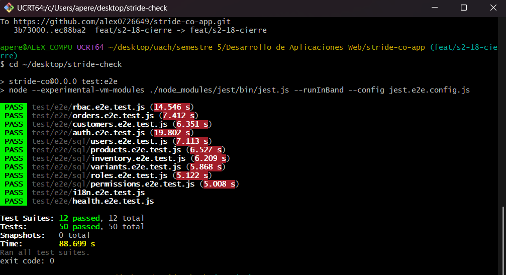

# Stride & Co.

Stride & Co. es una tienda deportiva que actualmente gestiona sus ventas mediante WhatsApp, hojas de cálculo y procesos manuales. Este proyecto digitaliza progresivamente esos procesos mediante una plataforma web que permita a los clientes consultar el catálogo, comprar y dar seguimiento a sus pedidos, y a los equipos de ventas y operaciones administrar pedidos, inventario y notificaciones desde un panel centralizado.

El proyecto se desarrolla como parte del curso Desarrollo de Aplicaciones Web, aplicando la metodología Scrum de forma iterativa e incremental a lo largo del semestre.

## Datos académicos

| Campo | Detalle |
|---|---|
| **Universidad** | Universidad Autónoma de Chihuahua |
| **Facultad** | Facultad de Ingeniería |
| **Carrera** | Ingeniería en Computación |
| **Materia** | Desarrollo de Aplicaciones Web |
| **Docente** | Mtro. Luis Antonio Ramírez Martínez |
| **Actividad** | Proyecto Integrador — Entregable 2. Backend completo, internacionalizado y desplegado sin costo |

## Equipo

| Integrante | Rol |
|---|---|
| Osvaldo Hernández Juárez | Product Owner |
| José Alejandro Pérez Millán | Scrum Master |
| Jenny Guadalupe Quintana Sánchez | Developer |
| Armando Velázquez Barroso | Developer |

Tablero de trabajo: [GitHub Project](https://github.com/users/alex0726649/projects/1). Las tareas del sprint están en [`tareas_sprint_2.md`](tareas_sprint_2.md).

## Contenido

- [API pública](#api-pública)
- [Estado actual](#estado-actual)
- [Instalación desde cero](#instalación-desde-cero)
- [Configuración y secretos](#configuración-y-secretos)
- [Bases de datos y datos iniciales](#bases-de-datos-y-datos-iniciales)
- [Ejecución y scripts](#ejecución-y-scripts)
- [API](#api)
- [Autenticación](#autenticación)
- [Control de acceso basado en roles](#control-de-acceso-basado-en-roles)
- [Internacionalización](#internacionalización)
- [Pruebas](#pruebas)
- [Estructura del proyecto](#estructura-del-proyecto)
- [Flujo de trabajo del equipo](#flujo-de-trabajo-del-equipo)

## API pública

La API está desplegada en Render desde la rama `staging` (auto-deploy en cada push), con Render PostgreSQL y MongoDB Atlas en sus planes gratuitos. El servicio web y la base PostgreSQL están en la región Oregon. El procedimiento completo para recrear el despliegue está en [`docs/deploy-render.md`](docs/deploy-render.md).

| Dato | Contenido |
|---|---|
| URL pública | <https://stride-co-app-staging.onrender.com> |
| Health Check | `GET /health` → `200 {"status":"UP"}`. Render lo usa como Health Check Path. |
| Usuarios de demostración | Ver la tabla siguiente. Son cuentas ficticias creadas por `npm run seed`. |
| Ejemplo de uso | Ver [Probar el despliegue](#probar-el-despliegue). |
| Render PostgreSQL | Plan gratuito, región Oregon. Creada el **11 de noviembre de 2026**; caduca el **11 de diciembre de 2026** (30 días). |
| MongoDB Atlas | Cluster gratuito M0 en AWS, región Oregon, base `stride_co`. Usuario de base de datos exclusivo del proyecto. Network Access: `0.0.0.0/0`, porque el plan gratuito de Render no tiene IP fija; el acceso queda protegido por el usuario y la contraseña del proyecto. |
| Secretos | `config/local-production.json` se carga en Render como **Secret File**. Ver [Secretos en producción](#secretos-en-producción). |

**Usuarios de demostración.** Las contraseñas son exclusivas de estas cuentas de prueba y no se usan en ningún otro lugar:

| Rol | Email | Contraseña | Qué puede hacer |
|---|---|---|---|
| `admin` | `admin@stride-demo.example` | `StrideDemo-Admin-2026!` | Todo |
| `sales` | `sales@stride-demo.example` | `StrideDemo-Sales-2026!` | Catálogo, inventario, clientes y solo sus órdenes asignadas |
| `user` | `user@stride-demo.example` | `StrideDemo-User-2026!` | Catálogo, su perfil de cliente y solo sus órdenes |

> El plan gratuito de Render suspende el servicio tras 15 minutos sin tráfico. La primera petición después de eso tarda alrededor de 50 segundos; consulta `/health` antes de probar.

### Probar el despliegue

Con `bash` (en PowerShell usa `curl.exe` en lugar de `curl`):

```bash
API=https://stride-co-app-staging.onrender.com

# 1. Despertar el servicio
curl $API/health

# 2. Iniciar sesión como admin y guardar el token
TOKEN=$(curl -s -X POST $API/api/auth/login \
  -H "Content-Type: application/json" \
  -d '{"email":"admin@stride-demo.example","password":"StrideDemo-Admin-2026!"}' \
  | node -pe 'JSON.parse(require("fs").readFileSync(0)).data.token')

# 3. Consultar un recurso permitido, en inglés
curl $API/api/products -H "Authorization: Bearer $TOKEN" -H "Accept-Language: en"

# 4. Mismo recurso en español
curl $API/api/products -H "Authorization: Bearer $TOKEN" -H "Accept-Language: es"
```

Para ver un `403`, inicia sesión como `sales` y consulta `GET /api/users`. Para ver un `401`, repite la consulta sin el encabezado `Authorization`.

### Secretos en producción

- Ningún secreto está en el repositorio ni dentro de la imagen de Docker. `.gitignore` y `.dockerignore` excluyen `config/local*.json` (salvo las plantillas `*.example.json`).
- En Render, el contenido de `config/local-production.json` se agrega como **Secret File** con ese mismo nombre. Render lo deja en `/etc/secrets/local-production.json` y el `CMD` del `Dockerfile` lo enlaza a `config/local-production.json` al arrancar el contenedor, no al construir la imagen.
- La plantilla [`config/local-production.example.json`](config/local-production.example.json) muestra la forma del archivo sin valores reales: `jwt.secret`, los datos de conexión de Render PostgreSQL y la URI de Atlas.
- En el servicio solo se definen las variables `NODE_ENV=production` y `PORT` (la segunda la asigna Render).

## Estado actual

El backend sigue esta arquitectura:

```
HTTP Request → Express → authenticate (JWT) → authorize (RBAC) → Controller → Modelo (Sequelize / Mongoose) → PostgreSQL / MongoDB
```

- **PostgreSQL + Sequelize:** usuarios, roles, permisos (relación N:M en `role_permission`), productos, variantes e inventario.
- **MongoDB + Mongoose:** clientes y órdenes.
- **Autenticación:** contraseñas con bcrypt, login que emite un JWT y middleware `authenticate` con `express-jwt`. Ver [Autenticación](#autenticación).
- **Autorización:** RBAC con `accesscontrol` en **todas** las rutas de la API; los permisos se leen de la base de datos en cada petición. Ver [Control de acceso basado en roles](#control-de-acceso-basado-en-roles).
- **Internacionalización:** respuestas en español e inglés. Ver [Internacionalización](#internacionalización).
- **Configuración por entornos** con el paquete `config`; los secretos viven fuera del repositorio. Ver [Configuración y secretos](#configuración-y-secretos).
- **Pruebas:** unitarias con mocks (`npm test`) y E2E contra la API en ejecución (`npm run test:e2e`). Ver [Pruebas](#pruebas).

Las entregas anteriores se conservan en el historial de Git. El estado del Entregable 1 puede consultarse en la etiqueta `entregable-1`.

### Tecnologías utilizadas

**Ejecución:** Node.js y Express · PostgreSQL con Sequelize (`pg`) · MongoDB con Mongoose · bcrypt · jsonwebtoken y express-jwt · accesscontrol (RBAC) · i18n · config (configuración por entornos) · Morgan · Pug · cookie-parser, debug, http-errors.

**Desarrollo:** Jest y Supertest · ESLint · Supervisor · cross-env · Docker · Google Antigravity (generación de pruebas E2E).

## Instalación desde cero

**Requisitos:** Node.js `^20.19.0 || ^22.13.0 || >=24` (ver `engines` en `package.json`), npm, Git, y PostgreSQL y MongoDB disponibles (en local con Docker, o MongoDB en Atlas).

1. Clonar e instalar dependencias:

   ```bash
   git clone https://github.com/alex0726649/stride-co-app.git
   cd stride-co-app
   git switch staging
   npm ci
   ```

   Se usa `npm ci` en lugar de `npm install` porque instala exactamente las versiones de `package-lock.json` sin modificarlo. Vuelve a ejecutarlo cada vez que un cambio traiga modificaciones en `package.json`.

2. Crear la configuración local a partir de la plantilla:

   ```bash
   cp config/local-development.example.json config/local-development.json
   ```

   En PowerShell:

   ```powershell
   Copy-Item config/local-development.example.json config/local-development.json
   ```

3. Abrir `config/local-development.json` y reemplazar los valores de ejemplo: `jwt.secret` (cualquier texto largo y aleatorio) y `db.postgres.password` (la contraseña de tu PostgreSQL local). Si usas Atlas para MongoDB, agrega también `db.mongo.uri`. Este archivo está excluido de Git: no lo compartas.

4. Preparar las bases de datos y cargar los datos iniciales, como se explica en [Bases de datos y datos iniciales](#bases-de-datos-y-datos-iniciales).

5. Iniciar la API:

   ```bash
   npm start
   ```

   La aplicación queda en `http://localhost:3000` y la API bajo `/api`.

## Configuración y secretos

La configuración se lee con el paquete [`config`](https://www.npmjs.com/package/config). El código obtiene cada valor con `config.get('ruta.del.valor')`; **la aplicación no lee `process.env` directamente**.

### Entornos

`NODE_ENV` elige el entorno. Si no se define, se usa `development`.

| `NODE_ENV` | Uso |
|---|---|
| `development` | Desarrollo local (`npm start`, `npm run dev`). |
| `test` | `npm test`. Usa `config/test.json`, que no necesita archivos locales ni bases de datos. |
| `production` | Render. |

### Archivos de `config/`

`config` combina los archivos en este orden; cada uno sobrescribe al anterior:

| Archivo | En Git | Contenido |
|---|---|---|
| `default.json` | Sí | Valores comunes sin secretos: puerto, opciones de JWT, costo de bcrypt, conexiones locales por defecto y URL base de las E2E. |
| `development.json`, `test.json`, `production.json` | Sí | Diferencias de cada entorno (por ejemplo, `bcrypt.saltRounds` 1 en pruebas y 12 en producción). |
| `local-development.json`, `local-production.json` | **No** | Secretos de cada entorno: `jwt.secret`, contraseñas y URIs de las bases. |
| `local-*.example.json` | Sí | Plantillas sin valores reales para crear los archivos locales. |
| `custom-environment-variables.json` | Sí | Mapea `PORT` a `server.port`. Es la única variable que sobrescribe la configuración. |

Si falta `jwt.secret`, el servidor no arranca y muestra un mensaje que indica qué configurar.

### Variables de entorno

Solo se usan dos:

| Variable | Efecto |
|---|---|
| `NODE_ENV` | Entorno activo (ver tabla anterior). |
| `PORT` | Puerto del servidor; sobrescribe `server.port` (por defecto `3000`). Render lo asigna automáticamente. |

```bash
PORT=4000 npm start
```

En PowerShell: `$env:PORT=4000; npm start`.

## Bases de datos y datos iniciales

### Desarrollo

| Base | Recursos | Configuración |
|---|---|---|
| PostgreSQL local | usuarios, roles, permisos, productos, variantes, inventario | `db.postgres` (por defecto `localhost:5432`, base `stride_co`, usuario `postgres`) |
| MongoDB local **o** cluster de Atlas | clientes, órdenes | `db.mongo.uri` (por defecto `mongodb://localhost:27017/stride_co`) |

Para levantar ambas en local con Docker (usa en `POSTGRES_PASSWORD` la misma contraseña que pusiste en `config/local-development.json`):

```bash
docker run -d --name stride-postgres \
  -e POSTGRES_PASSWORD=<tu-contraseña> \
  -e POSTGRES_DB=stride_co \
  -p 5432:5432 \
  postgres:16

docker run -d --name stride-mongo -p 27017:27017 mongo:7
```

En las siguientes sesiones basta con `docker start stride-postgres stride-mongo`. Si prefieres Atlas para MongoDB, pon la URI de tu cluster en `db.mongo.uri` de `config/local-development.json`.

Al arrancar, el servidor ejecuta `sequelize.sync()` para crear las tablas que no existen y `database/ensure-constraints.js` para aplicar restricciones (precio y existencias no negativas, `reserved <= stock`, nombre de rol único). `sync()` no modifica tablas existentes; si cambia un modelo, recrea la base de desarrollo. El esquema está documentado en [`database/README.md`](database/README.md). Si alguna de las dos bases no está disponible, el servidor no inicia.

### Datos iniciales (`npm run seed`)

```bash
npm run seed
```

Usa la configuración del `NODE_ENV` activo, así que el mismo comando sirve en local y contra las bases de producción. Carga:

- la matriz RBAC completa (`roles`, `permissions` y `role_permission`) desde [`database/rbac-matrix.json`](database/rbac-matrix.json);
- un usuario activo por rol (los [usuarios de demostración](#api-pública));
- un producto con su variante e inventario;
- dos clientes con una orden cada uno: una pertenece al usuario `user` y la otra no, para probar `own` contra `any`.

Es idempotente: se puede ejecutar varias veces sin duplicar datos. Las cuentas que ya existen conservan su contraseña.

## Ejecución y scripts

| Comando | Descripción |
|---|---|
| `npm start` | Inicia el servidor con `node ./bin/www`, en el entorno de `NODE_ENV` (por defecto `development`). |
| `npm run dev` | Inicia el servidor con Supervisor y lo reinicia al detectar cambios. |
| `npm run lint` | Ejecuta ESLint. Debe terminar sin errores. |
| `npm test` | Pruebas unitarias y de integración con mocks. No requiere bases de datos. |
| `npm run test:e2e` | Pruebas E2E contra la API en ejecución. Ver [Pruebas E2E](#pruebas-e2e). |
| `npm run seed` | Carga los datos iniciales en PostgreSQL y MongoDB. |
| `npm run seed:rbac` | Carga solo la matriz RBAC en PostgreSQL. |

## API

Todos los endpoints se publican bajo `/api`, salvo `GET /health`.

### Arquitectura

| Capa | Ubicación | Responsabilidad |
|---|---|---|
| Montaje | `app.js` | Registra middlewares (Morgan, i18n, JSON) y asocia cada router a su ruta base. |
| Middleware | `middlewares/` | `authenticate` (JWT) y `authorize` (RBAC). |
| Ruta | `routes/` | Define el endpoint y su cadena `authenticate → authorize → controller`. No contiene lógica. |
| Controlador | `controllers/` | Valida la solicitud, usa el modelo y construye la respuesta traducida. |
| Modelo | `models/relationals/`, `models/documents/` | Entidades de Sequelize y Mongoose, con sus validaciones. |
| Utilidades | `utils/` | Hash de contraseñas, formato de respuesta y carga de permisos RBAC. |

### Formato de respuesta

Todas las respuestas de los recursos siguen la misma estructura. `message` está traducido al idioma de la petición:

```json
{
  "message": "Producto encontrado",
  "data": {}
}
```

`data` contiene un objeto, un arreglo o `null`. En los errores, `data` es `null`. Las respuestas nunca incluyen `password`, `password_hash` ni `salt_key`.

### Códigos de estado

| Código | Situación |
|---|---|
| `200` | Consulta, actualización o eliminación correcta. |
| `201` | Creación correcta. |
| `400` | Cuerpo inválido, campos faltantes, tipos incorrectos, ID mal formado o valor único repetido. |
| `401` | Credenciales inválidas, token ausente, inválido o expirado, o usuario inactivo. |
| `403` | El rol no tiene el permiso, o el recurso no le pertenece (`own`). |
| `404` | Recurso inexistente o ruta no registrada. |
| `500` | Error inesperado; se responde sin detalles internos. |

### Tabla de endpoints

Todas las rutas de recursos pasan por `authenticate` y después por `authorize`. Cuando la columna dice `own`, un rol con el permiso `any` correspondiente también pasa.

| Método | Ruta | Permiso RBAC | Descripción |
|---|---|---|---|
| GET | `/health` | Público | Estado del servicio (`{"status":"UP"}`). |
| POST | `/api/auth/login` | Público | Inicia sesión y devuelve un JWT. |
| GET | `/api/auth/me` | Solo JWT | Datos del usuario autenticado. |
| GET | `/api/users` | `users:read:any` | Lista usuarios con su rol. |
| GET | `/api/users/:id` | `users:read:any` | Consulta un usuario. |
| POST | `/api/users` | `users:create:any` | Crea un usuario (hash y salt con bcrypt). |
| PUT | `/api/users/:id` | `users:update:any` | Actualiza un usuario; regenera hash y salt si cambia la contraseña. |
| DELETE | `/api/users/:id` | `users:delete:any` | Elimina un usuario. |
| GET | `/api/roles` | `roles:read:any` | Lista roles con sus permisos. |
| GET | `/api/roles/:id` | `roles:read:any` | Consulta un rol con sus permisos. |
| POST | `/api/roles` | `roles:create:any` | Crea un rol; `permission_ids` asigna permisos existentes. |
| PUT | `/api/roles/:id` | `roles:update:any` | Actualiza un rol; `permission_ids` reemplaza sus permisos. |
| DELETE | `/api/roles/:id` | `roles:delete:any` | Elimina un rol sin usuarios asignados. |
| GET | `/api/permissions` | `permissions:read:any` | Lista permisos con los roles que los tienen. |
| GET | `/api/permissions/:id` | `permissions:read:any` | Consulta un permiso. |
| POST | `/api/permissions` | `permissions:create:any` | Crea un permiso con key `recurso:acción:alcance`. |
| PUT | `/api/permissions/:id` | `permissions:update:any` | Actualiza un permiso. |
| DELETE | `/api/permissions/:id` | `permissions:delete:any` | Elimina un permiso no asignado a roles. |
| GET | `/api/products` | `products:read:any` | Lista productos con sus variantes. |
| GET | `/api/products/:id` | `products:read:any` | Consulta un producto con sus variantes. |
| POST | `/api/products` | `products:create:any` | Crea un producto. |
| PUT | `/api/products/:id` | `products:update:any` | Actualiza un producto. |
| DELETE | `/api/products/:id` | `products:delete:any` | Elimina un producto. |
| GET | `/api/variants` | `variants:read:any` | Lista variantes (talla, color, SKU). |
| GET | `/api/variants/:id` | `variants:read:any` | Consulta una variante con su producto e inventario. |
| POST | `/api/variants` | `variants:create:any` | Crea una variante de un producto existente. |
| PUT | `/api/variants/:id` | `variants:update:any` | Actualiza una variante. |
| DELETE | `/api/variants/:id` | `variants:delete:any` | Elimina una variante. |
| GET | `/api/inventory` | `inventory:read:any` | Lista existencias (`stock` y `reserved`). |
| GET | `/api/inventory/:id` | `inventory:read:any` | Consulta un registro de inventario. |
| PUT | `/api/inventory/:id` | `inventory:update:any` | Ajusta `stock` y `reserved` (ambos obligatorios, `reserved <= stock`). |
| GET | `/api/customers` | `customers:read:any` | Lista clientes. |
| GET | `/api/customers/:id` | `customers:read:own` | Consulta un cliente; `user` solo el suyo. |
| POST | `/api/customers` | `customers:create:own` | Registra un cliente; `user` solo para sí mismo. |
| PUT | `/api/customers/:id` | `customers:update:own` | Actualiza un cliente; `user` solo el suyo. |
| DELETE | `/api/customers/:id` | `customers:delete:any` | Elimina un cliente. |
| GET | `/api/orders` | `orders:read:any` | Lista todas las órdenes con los datos del cliente. |
| GET | `/api/orders/:id` | `orders:read:own` | Consulta una orden; `sales` solo las asignadas y `user` solo las suyas. |
| POST | `/api/orders` | `orders:create:own` | Crea una orden; `user` solo para su propio perfil de cliente. |
| PUT | `/api/orders/:id` | `orders:update:own` | Actualiza una orden; `sales` solo las asignadas. |
| DELETE | `/api/orders/:id` | `orders:delete:any` | Elimina una orden. |

El inventario no se crea ni se elimina por separado: cada registro existe junto con su variante. El contrato original de la API está en [`docs/api.md`](docs/api.md).

### Reglas de los recursos

- **Roles:** el nombre es obligatorio (máximo 50 caracteres) y único. Un rol con usuarios asignados no se puede eliminar.
- **Permisos:** la `key` sigue el formato `recurso:acción:alcance` y es única. Un permiso asignado a roles no se puede eliminar: primero se retira del rol con `PUT /api/roles/:id`.
- **Órdenes:** se crean con `customerId`, `paymentMethod` (`efectivo` o `transferencia`) y al menos un artículo con `productId` y `quantity`. Una compra con `orders:create:own` empieza en `Pendiente de pago` y sin vendedor elegido por el comprador; también existen los estados `Pagado` y `Cancelado`. Si se envía `salesPersonId`, debe ser una cuenta con rol `sales`. El servidor toma el precio del catálogo y calcula el subtotal.

## Autenticación

### Contraseñas

`utils/password.js` usa `bcrypt.genSalt`, `bcrypt.hash` y `bcrypt.compare`. Al crear un usuario o cambiar su contraseña se generan un salt y un hash nuevos, guardados en `salt_key` y `password_hash`. El costo sale de `bcrypt.saltRounds` en la configuración. La contraseña en texto plano no se almacena, y `User.toJSON()` excluye `password`, `password_hash` y `salt_key` de todas las respuestas.

### Inicio de sesión

`POST /api/auth/login` acepta JSON o `application/x-www-form-urlencoded` con `email` y `password`. Si el usuario existe, está activo y la contraseña coincide, responde `200`:

```json
{
  "message": "Inicio de sesión correcto",
  "data": {
    "token": "<token generado>",
    "token_type": "Bearer",
    "expiresIn": "15m"
  }
}
```

El token se firma con `HS256` usando `jwt.secret`. Lleva el identificador del usuario en `sub`, además de emisión, expiración, emisor (`jwt.issuer`) y destinatario (`jwt.audience`); nunca contraseñas ni hashes.

### Rutas protegidas

Se envía el token en el encabezado:

```http
Authorization: Bearer <token>
```

En Postman: **Authorization → Bearer Token**. `middlewares/authenticate.js` verifica con `express-jwt` la firma, el algoritmo, la expiración, el emisor y el destinatario; después busca al usuario de `sub`, comprueba que exista y esté activo, y lo asigna a `req.user`. Un usuario eliminado o desactivado no puede usar un token emitido antes.

| Prueba | Resultado esperado |
|---|---|
| Login con credenciales correctas y usuario activo | `200`, con token |
| Login con email o contraseña incompletos | `400` |
| Login con credenciales incorrectas o usuario inactivo | `401`, mensaje genérico |
| Ruta protegida sin token, con token inválido o expirado | `401` |
| Ruta protegida con token de un usuario inexistente o inactivo | `401` |
| `GET /api/auth/me` con token válido | `200` con los datos seguros del usuario |

## Control de acceso basado en roles

La autenticación responde **quién eres** (`401` si no hay sesión válida); RBAC responde **qué puedes hacer** (`403` si el rol no tiene el permiso). Todas las rutas de recursos de la [tabla de endpoints](#tabla-de-endpoints) están protegidas.

```
User -> Role -> Role_Permission -> Permission -> accesscontrol -> authorize() -> endpoint
```

### Roles utilizados

| Rol | Quién es en Stride & Co. | Resumen |
|---|---|---|
| `admin` | Dueña del negocio | Acceso total a catálogo, inventario, órdenes, clientes, usuarios, roles y permisos. |
| `sales` | Vendedor | Consulta catálogo, inventario y clientes, crea órdenes y consulta o actualiza **solo las órdenes que tiene asignadas** (`salesPersonId`). |
| `user` | Cliente | Consulta el catálogo, gestiona su propio perfil de cliente, crea órdenes para él y consulta **solo sus órdenes**. |

### Convención de `Permission.key`

Cada permiso se identifica con `recurso:acción:alcance`:

```
orders:read:own
  |     |    |
  |     |    +-- alcance (possession): own | any
  |     +------- acción (action): create | read | update | delete
  +------------- recurso (resource): products, orders, customers, ...
```

- `any`: puede operar sobre **cualquier** recurso de ese tipo.
- `own`: solo sobre recursos **relacionados con el usuario**. Un permiso `any` incluye al `own` correspondiente.

La API rechaza con `400` una key que no siga este formato (`POST` y `PUT /api/permissions`), porque el RBAC la ignoraría sin dar acceso.

### Matriz RBAC

La matriz completa son 36 permisos. Es la misma de [`database/rbac-matrix.json`](database/rbac-matrix.json) que carga `npm run seed`, y la misma que usan las pruebas.

| Permission.key | admin | sales | user |
|---|:-:|:-:|:-:|
| `products:read:any` | ✓ | ✓ | ✓ |
| `products:create:any` | ✓ | — | — |
| `products:update:any` | ✓ | — | — |
| `products:delete:any` | ✓ | — | — |
| `variants:read:any` | ✓ | ✓ | ✓ |
| `variants:create:any` | ✓ | — | — |
| `variants:update:any` | ✓ | — | — |
| `variants:delete:any` | ✓ | — | — |
| `inventory:read:any` | ✓ | ✓ | — |
| `inventory:update:any` | ✓ | — | — |
| `orders:create:any` | ✓ | ✓ | — |
| `orders:create:own` | — | — | ✓ |
| `orders:read:any` | ✓ | — | — |
| `orders:read:own` | — | ✓ | ✓ |
| `orders:update:any` | ✓ | — | — |
| `orders:update:own` | — | ✓ | — |
| `orders:delete:any` | ✓ | — | — |
| `customers:create:any` | ✓ | — | — |
| `customers:read:any` | ✓ | ✓ | — |
| `customers:update:any` | ✓ | — | — |
| `customers:delete:any` | ✓ | — | — |
| `customers:create:own` | — | — | ✓ |
| `customers:read:own` | — | — | ✓ |
| `customers:update:own` | — | — | ✓ |
| `users:create:any` | ✓ | — | — |
| `users:read:any` | ✓ | — | — |
| `users:update:any` | ✓ | — | — |
| `users:delete:any` | ✓ | — | — |
| `roles:create:any` | ✓ | — | — |
| `roles:read:any` | ✓ | — | — |
| `roles:update:any` | ✓ | — | — |
| `roles:delete:any` | ✓ | — | — |
| `permissions:create:any` | ✓ | — | — |
| `permissions:read:any` | ✓ | — | — |
| `permissions:update:any` | ✓ | — | — |
| `permissions:delete:any` | ✓ | — | — |

**Decisión de dominio:** `sales` **no** tiene `orders:read:any`. La historia HU-11 (*Aislamiento de pedidos por vendedor*) exige que un vendedor solo vea y modifique sus propios pedidos y reciba `403` al abrir por URL un pedido de otro vendedor.

### Qué significa "propio" (`own`)

La pertenencia se comprueba contra el documento **guardado en la base de datos**, nunca contra datos enviados en el body o la URL:

| Recurso | Es propio si... |
|---|---|
| `orders` (rol `sales`) | `order.salesPersonId === req.user.id` |
| `orders` (rol `user`) | la orden apunta a un `customer` cuyo `userId === req.user.id` |
| `orders` al crear (`orders:create:own`) | el `customerId` enviado corresponde a un `customer` cuyo `userId === req.user.id` |
| `customers` | `customer.userId === req.user.id` |
| `customers` al crear (`customers:create:own`) | el `userId` enviado es el del usuario autenticado |

Uso en una ruta (`routes/orders.js`):

```javascript
router.get('/', authenticate, authorize('orders', 'read', 'any'), controller.list);
router.get('/:id', authenticate, controller.validateId, authorize('orders', 'read', 'own'), controller.find);
```

En las rutas que piden `own`, un rol con el permiso `any` pasa directo (por ejemplo, `admin` en `GET /api/orders/:id`); un rol que solo tiene `own` debe además ser dueño del recurso.

### Ejemplo de permiso `any`

`DELETE /api/products/1` requiere `products:delete:any`:

| Rol | ¿Tiene `products:delete:any`? | Respuesta |
|---|---|---|
| `admin` | Sí | `200` |
| `sales` | No | `403 { "message": "Prohibido", "data": null }` |

### Ejemplo de permiso `own`

`GET /api/orders/:id` requiere `orders:read:own`. El cliente con `id = 10` es dueño del customer `A`; el cliente `11` es dueño del customer `B`:

| Usuario (rol `user`) | Orden solicitada | Comprobación en la BD | Respuesta |
|---|---|---|---|
| `10` | Orden del customer `A` | `A.userId (10) === 10` | `200` |
| `10` | Orden del customer `B` | `B.userId (11) !== 10` | `403` |
| `10` | `GET /api/orders` (todas) | `user` no tiene `orders:read:any` | `403` |

Con los datos del seed se reproduce con el usuario demo `user`: una de las dos órdenes sembradas es suya (`200`) y la otra no (`403`).

### Cómo se obtienen los permisos desde la base de datos

La **fuente de verdad es la base de datos**; el código no contiene permisos por rol.

1. **Carga inicial.** `database/rbac-matrix.json` describe la matriz como datos y `npm run seed` (o solo `npm run seed:rbac`) la escribe en `roles`, `permissions` y `role_permission`. Valida el formato de cada key, es idempotente y usa una transacción. La aplicación **nunca** importa el JSON.

2. **Lectura en cada petición.** `loadRoleAccess(roleId)` en `utils/rbac.js` consulta el rol del usuario con sus permisos mediante Sequelize (une `roles`, `role_permission` y `permissions`). Cada `Permission.key` se separa en `resource`, `action` y `possession` y se convierte en un *grant* de `accesscontrol`:

   ```
   'orders:read:own'  ->  { role: 'user', resource: 'orders', action: 'read:own', attributes: '*' }
   ```

3. **Decisión.** `authorize(resource, action, possession)` en `middlewares/authorize.js` pregunta a `accesscontrol` si el rol tiene el permiso; si el alcance es `own`, además comprueba la pertenencia real del recurso. Si no se cumple, responde `403`.

Como los permisos se leen en cada petición, un cambio hecho con `PUT /api/roles/:id` o directamente en `role_permission` se aplica de inmediato, sin reiniciar el servidor (lo comprueba `test/rbac-loader.test.js`).

### Respuestas de autorización

| Situación | Código | `message` (es / en) |
|---|---|---|
| Sin token, token inválido o expirado, usuario inexistente o inactivo | `401` | `No autorizado` / `Unauthorized` |
| Autenticado, pero el rol no tiene el permiso | `403` | `Prohibido` / `Forbidden` |
| Autenticado con `own`, pero el recurso no le pertenece | `403` | `Prohibido` / `Forbidden` |
| Autenticado y autorizado | — | Continúa al controller |

## Internacionalización

### Idiomas

La API responde en **español** (`es`, predeterminado) e **inglés** (`en`). Se traducen los mensajes de todos los recursos, los errores comunes (`401`, `403`, `404`, `500`, JSON inválido) y las vistas Pug. La respuesta incluye el encabezado `Content-Language`.

### Cómo elegir el idioma

El idioma se decide en este orden:

1. Parámetro de consulta `?lang=en`.
2. Encabezado `Accept-Language`. Las variantes regionales se resuelven al idioma base (`es-MX` → `es`).
3. Español, si no se indica nada o el idioma no está soportado (`?lang=fr`).

```bash
curl "http://localhost:3000/api/no-existe?lang=en"
curl -H "Accept-Language: es-MX" http://localhost:3000/api/no-existe
```

### Cómo agregar un idioma

1. Copiar `locales/es.json` como `locales/<código>.json` (por ejemplo `fr.json`) y traducir **todos** los valores sin cambiar las claves.
2. Agregar el código a `locales` en `config/i18n.js`.
3. Ampliar las pruebas de `test/i18n.test.js` con la detección del nuevo idioma.

Los catálogos están organizados por recurso (`users.notFound`, `roles.nameTaken`, `errors.forbidden`…). En los controllers se usa `req.__('recurso.clave')` y en Pug `__('clave')`. Cada clave nueva se agrega **a la vez** en todos los catálogos; `test/i18n.test.js` falla si algún archivo tiene claves de más o de menos.

## Pruebas

```bash
npm run lint
npm test
npm run test:e2e
```

Los tres comandos deben terminar sin errores.

### Pruebas con mocks (`npm test`)

Usan Jest y Supertest contra `app.js` sin levantar el servidor. `test/setup.js` sustituye las consultas de Sequelize y Mongoose por dobles de prueba con `jest.spyOn`, y bloquea cualquier consulta SQL real como protección adicional. **No necesitan bases de datos ni archivos locales**: usan `config/test.json`.

Cada recurso tiene su archivo (`test/<recurso>.test.js`) y cubre éxito, `400`, `401`, `403`, `404` y `500`, además de las traducciones. También hay pruebas de:

| Archivo | Qué comprueba |
|---|---|
| `test/app.test.js` | Rutas inexistentes, JSON malformado, errores ocultos en producción y registro de Morgan. |
| `test/auth.test.js` | Login, firma del JWT, tokens inválidos o expirados y `/api/auth/me`. |
| `test/startup.test.js` | Arranque sin `jwt.secret` y uso de `PORT`. |
| `test/i18n.test.js` | Detección de idioma y que `es.json` y `en.json` tengan las mismas claves. |
| `test/rbac-loader.test.js` | Separación de keys, construcción de grants y lectura de permisos desde la BD. |
| `test/authorize.test.js` | El middleware con `any`, `own`, `401` y `403`. |
| `test/rbac.test.js` | `admin` borra un producto, `sales` recibe `403`, y los casos `401` sin token. |

Para ejecutar un solo archivo: `npm test -- test/roles.test.js`.

### Pruebas E2E

Las suites de `test/e2e/` llaman a la **API en ejecución** con Supertest; no importan `app.js` ni usan mocks. Se generaron con Google Antigravity desde la terminal con la cuenta UACH y el equipo las revisó y corrigió. El proceso completo (prompts, correcciones y verificación de que cada prueba falla al romper el código) está en [`docs/e2e-antigravity.md`](docs/e2e-antigravity.md).

| Suite | Qué cubre |
|---|---|
| `health`, `auth` | `/health`, login y `/api/auth/me`. |
| `rbac` | Los escenarios de autorización `any` y `own` con los tres roles. |
| `i18n` | Respuestas en español e inglés con `?lang` y `Accept-Language`. |
| `sql/` | Ciclo completo de users, roles, permissions, products, variants e inventory. |
| `customers`, `orders` | Ciclo completo de los recursos de MongoDB y la relación orden → cliente. |
| **Total** | **12 suites y 50 pruebas.** |

Cada suite limpia en `afterAll` lo que crea, así que se pueden ejecutar varias veces seguidas.

**En local:**

```bash
npm run seed          # una vez, con las bases disponibles
npm start             # en otra terminal
npm run test:e2e
```

**Contra Render:** primero consulta `/health` para despertar el servicio. La URL se pasa solo al runner de pruebas:

```bash
E2E_BASE_URL=https://stride-co-app-staging.onrender.com npm run test:e2e
```

En PowerShell: `$env:E2E_BASE_URL="https://stride-co-app-staging.onrender.com"; npm run test:e2e`.

La URL por defecto sale de `e2e.baseUrl` en `config/default.json` (`http://localhost:3000`). Las pruebas inician sesión con los [usuarios de demostración](#api-pública).

Resultado de `npm run test:e2e` contra Render (12 suites y 50 pruebas en verde, validado en la S2-18):



La validación completa de la entrega (clonación limpia, pruebas locales y contra Render, revisión de secretos, ramas y Project) está en [`docs/sprint2-validacion.md`](docs/sprint2-validacion.md).

## Estructura del proyecto

```text
stride-co-app/
|-- bin/www                    Punto de entrada: conecta PostgreSQL y MongoDB e inicia el servidor
|-- config/
|   |-- default.json           Configuración común sin secretos
|   |-- development.json, test.json, production.json
|   |-- custom-environment-variables.json   Mapeo de PORT
|   |-- local-*.example.json   Plantillas de los archivos de secretos
|   |-- i18n.js                Configuración de idiomas
|   |-- sequelize.js           Conexión a PostgreSQL
|   `-- mongoose.js            Conexión a MongoDB
|-- controllers/               Lógica de cada recurso
|-- database/
|   |-- rbac-matrix.json       Matriz RBAC (fuente del seed)
|   |-- seed.js                npm run seed
|   |-- seed-rbac.js           npm run seed:rbac
|   |-- ensure-constraints.js  Restricciones aplicadas al iniciar
|   |-- schema.sql             Esquema SQL de catálogo e inventario
|   `-- README.md              Documentación del esquema relacional
|-- docs/
|   |-- api.md                 Contrato de la API
|   |-- deploy-render.md       Despliegue en Render, PostgreSQL y Atlas
|   |-- e2e-antigravity.md     Registro de las pruebas E2E con Antigravity
|   |-- sprint2-validacion.md  Validación de la entrega del Sprint 2
|   |-- evidencias/            Logs de las rupturas E2E y reporte de validación
|   |-- img/                   Capturas de las pruebas y del despliegue
|   |-- product-backlog.md     Product Backlog
|   `-- transcripcion-cliente.md  Entrevista con el cliente
|-- locales/                   Catálogos de traducción (es.json, en.json)
|-- middlewares/
|   |-- authenticate.js        Verificación de JWT y carga del usuario
|   `-- authorize.js           Autorización RBAC
|-- models/
|   |-- relationals/           Modelos de Sequelize
|   `-- documents/             Modelos de Mongoose
|-- routes/                    Definición de endpoints
|-- scripts/
|   `-- e2e-rupturas.js        Evidencia: rompe cada prueba E2E a propósito
|-- test/                      Pruebas con mocks (Jest y Supertest)
|   `-- e2e/                   Pruebas E2E contra la API en ejecución
|-- utils/
|   |-- password.js            Hash y verificación con bcrypt
|   |-- rbac.js                Carga de permisos desde la BD
|   `-- response.js            Formato { message, data }
|-- views/                     Plantillas Pug
|-- app.js                     Middlewares y montaje de routers
|-- Dockerfile                 Imagen para Render
|-- eslint.config.js
|-- jest.config.js             Pruebas con mocks
|-- jest.e2e.config.js         Pruebas E2E
`-- package.json
```

## Flujo de trabajo del equipo

El trabajo se organiza en tarjetas del GitHub Project. En este sprint, todas las ramas salen de `staging` y regresan a `staging` por Pull Request:

1. Asignarse la tarjeta y moverla a *En progreso*.
2. Crear la rama desde `staging` actualizada:

   ```bash
   git switch staging
   git pull
   git switch -c feat/s2-XX-nombre
   ```

3. Trabajar únicamente el alcance de la tarjeta.
4. Ejecutar `npm run lint` y `npm test` antes de subir.
5. Publicar la rama y abrir el Pull Request hacia `staging`:

   ```bash
   git push -u origin feat/s2-XX-nombre
   gh pr create --base staging
   ```

6. Solicitar revisión a un integrante distinto del autor. El merge lo realiza quien revisa, con **Create a merge commit** para conservar los commits y su autoría. Las ramas no se borran al hacer merge.

### Convención de commits

Se utiliza [Conventional Commits](https://www.conventionalcommits.org/) con el formato `tipo(ámbito): descripción`:

```
feat(roles): proteger y traducir el recurso roles
fix(users): validar contraseña al crear usuario
docs(readme): documentar la API pública
test(e2e): add SQL resources suites (generated with Antigravity, reviewed)
chore(deploy): desplegar en Render con PostgreSQL y Atlas
```

La descripción se escribe en minúscula, en imperativo y sin punto final.