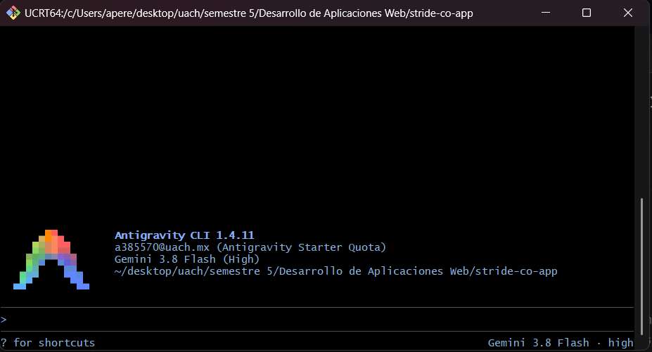

# Pruebas E2E generadas con Google Antigravity

Tarjeta **S2-14 · E2E base** · Rama `feat/s2-14-e2e-base` · Equipo **CodeMen**

Este documento registra cómo se generaron las suites E2E base con **Google Antigravity CLI (`agy`)** desde la terminal con la cuenta institucional UACH: los prompts en orden, qué produjo el agente, qué corrigió el equipo y por qué, y la verificación de que cada prueba falla cuando se rompe a propósito.

---

## 1. Sesión

| Dato | Valor |
|---|---|
| Herramienta | Google Antigravity CLI (`agy`) |
| Versión | `1.5.5` |
| Cuenta | Institucional UACH |
| Fecha | 10 de noviembre de 2026 |
| Permisos del agente | `request-review` (cada edición y comando se aprobó manualmente) |
| Contexto que leyó el agente | `README.md`, `app.js`, `routes/`, `controllers/`, `middlewares/`, `models/`, `database/rbac-matrix.json`, `database/seed-postgres.js`, `locales/es.json`, `locales/en.json`, `config/`, `package.json` |



---

## 2. Cómo correr las pruebas

Las E2E llaman a la API **en ejecución**; no importan `app.js` ni usan los mocks de `test/setup.js`.

```bash
# 1. Bases de datos disponibles (PostgreSQL local y MongoDB Atlas, según config/local-development.json)
npm run seed

# 2. API en otra terminal
npm start

# 3. Pruebas E2E
npm run test:e2e

# Contra otra URL (solo el runner lee esta variable)
E2E_BASE_URL=https://<host> npm run test:e2e
```

| Comando | Qué corre |
|---|---|
| `npm test` | Pruebas unitarias e integración (16 suites, 363 pruebas). Ignora `test/e2e/`. |
| `npm run test:e2e` | Suites E2E con `jest.e2e.config.js` (4 suites, 33 pruebas), sin `setupFiles`. |

La URL base sale de `config.get('e2e.baseUrl')` (por defecto `http://localhost:3000`). `E2E_BASE_URL` solo se lee en `test/e2e/helpers.js`; el código de la aplicación no lee `process.env`.

---

## 3. Archivos

| Archivo | Contenido |
|---|---|
| `config/default.json` | Nueva sección `"e2e": { "baseUrl": "http://localhost:3000" }` |
| `jest.config.js` | `testPathIgnorePatterns: ['/node_modules/', '/test/e2e/']` |
| `jest.e2e.config.js` | `testMatch` de `test/e2e/**/*.e2e.test.js`, `testEnvironment: 'node'`, `testTimeout: 20000`, sin `setupFiles` |
| `package.json` | Script `test:e2e` |
| `test/e2e/helpers.js` | `api()` (Supertest contra la URL), `login(rol)` y `DEMO_CREDENTIALS` |
| `test/e2e/health.e2e.test.js` | `GET /health` → 200 `{"status":"UP"}` |
| `test/e2e/auth.e2e.test.js` | Login por rol, credenciales inválidas, 400, rutas protegidas, exclusión de `password_hash`/`salt_key` |
| `test/e2e/rbac.e2e.test.js` | Los cinco escenarios de la Tarea 6 y 400 por datos inválidos |
| `test/e2e/i18n.e2e.test.js` | Mensajes en `es`/`en` por `Accept-Language`, `?lang` e idioma por defecto |

---

## 4. Prompts en orden

| # | Prompt | Resultado | Captura |
|---|---|---|---|
| 1 | Infraestructura E2E | `config/default.json`, `jest.config.js`, `jest.e2e.config.js`, `package.json` | [prompt1](img/e2e/prompt1.png) |
| 1.1 | Corrección de la infraestructura | Ajustes de `testPathIgnorePatterns` y `testTimeout` | [prompt1-corregido](img/e2e/prompt1-corregido.png) |
| 2 | Helpers | `test/e2e/helpers.js` | [prompt2](img/e2e/prompt2.png) |
| 3 | Health | `test/e2e/health.e2e.test.js` | [prompt3](img/e2e/prompt3.png) |
| 4 | Auth | `test/e2e/auth.e2e.test.js` | [prompt4](img/e2e/prompt4.png) |
| 4.1 | Corrección de auth | Mensajes por clave de locales, correo inexistente, credenciales desde helpers | [prompt4-corrections](img/e2e/prompt4-corrections.png) |
| 5 | RBAC | `test/e2e/rbac.e2e.test.js` | [prompt5](img/e2e/prompt5.png) |
| 5.1 | Corrección de RBAC | Limpieza con aviso, cuerpos reales de órdenes, reutilizar customer | [prompt5-corrections](img/e2e/prompt5-corrections.png) |
| 5.2 | Corrección de RBAC | Id directo de `/api/auth/me` | [prompt5-corrections2](img/e2e/prompt5-corrections2.png) |
| 6 | i18n | `test/e2e/i18n.e2e.test.js` | [prompt6](img/e2e/prompt6.png) |
| 6.1 | Corrección de i18n | Idioma por defecto y textos `es` ≠ `en` | [prompt6-corrections](img/e2e/prompt6-corrections.png) |
| 7 | 400 por datos inválidos | Caso agregado a `rbac.e2e.test.js` | [prompt7](img/e2e/prompt7.png) |

El texto completo de cada prompt está en el [Anexo A](#anexo-a-prompts-completos).

---

## 5. Qué generó el agente y qué corrigió el equipo

| Archivo | Lo que generó el agente | Corrección del equipo | Por qué |
|---|---|---|---|
| `jest.config.js` | `testPathIgnorePatterns: ['/test/e2e/']` | Se agregó `'/node_modules/'` | Definir la opción reemplaza el valor por defecto de Jest |
| `jest.e2e.config.js` | Sin `testTimeout` | `testTimeout: 20000` | Las pruebas llaman a la API real y MongoDB está en Atlas; 5 s no alcanzan |
| `helpers.js` | `api()`, `login(rol)` con ruta `/api/auth/login` y token en `data.token` | Sin cambios de lógica; se exportó `DEMO_CREDENTIALS` | Se verificó con `curl` contra la API y contra `DEMO_USERS` de `database/seed-postgres.js` |
| `health.e2e.test.js` | 200, `content-type` JSON y cuerpo exacto `{ status: 'UP' }` | Sin correcciones | Coincide con el controlador |
| `auth.e2e.test.js` | Mensajes escritos a mano y sin `Accept-Language` | Envía `Accept-Language: es` y compara contra `locales/es.json` por clave | Las pruebas no deben depender del idioma por defecto ni de textos copiados |
| `auth.e2e.test.js` | No cubría correo inexistente | Caso de correo inexistente con body idéntico al de contraseña incorrecta | Evita enumerar usuarios por la respuesta del login |
| `auth.e2e.test.js` | Credenciales demo repetidas | Se toman de `helpers.js` | Una sola fuente de verdad |
| `rbac.e2e.test.js` | `try/catch` silencioso en `afterAll` | Revisa el status de cada `DELETE` y hace `console.warn` si no es 200 ni 404 | Supertest no lanza error con 4xx, así que la limpieza podía fallar en silencio |
| `rbac.e2e.test.js` | Siempre creaba un customer para `user` | Reutiliza el customer existente de `user` | Evita duplicados en corridas repetidas |
| `rbac.e2e.test.js` | Cuerpo de orden supuesto | Validado contra `order-fields.js` y `order.js` | `paymentMethod` solo acepta `efectivo` o `transferencia`; el precio lo calcula el servidor |
| `rbac.e2e.test.js` | Id de `/api/auth/me` con fallback a `data.id` | Usa `meRes.body.id` directo | `/api/auth/me` responde el usuario en la raíz; el fallback escondía el contrato real |
| `rbac.e2e.test.js` (400) | `POST /api/products` sin `name` → 400 | Sin correcciones | Verificado contra `validate()` de `controllers/products.js`; registra el id antes de los `expect` para limpiar |
| `i18n.e2e.test.js` | Casos `es`/`en`, `?lang`, prioridad de `?lang` y `Content-Language` | Caso sin encabezado (idioma por defecto) y `expect(es).not.toBe(en)` antes de comparar | Si ambos textos fueran iguales, la prueba pasaría sin validar el cambio de idioma |

---

## 6. Verificación «romper a propósito»

Cada prueba se modificó a propósito, se ejecutó, se confirmó que fallaba y se revirtió con `git restore`. Todas fallaron como se esperaba.

| # | Suite | Prueba | Cambio hecho | Resultado esperado | ¿Falló? | Captura |
|---|---|---|---|---|---|---|
| H1 | health | `GET /health` 200 UP | Esperado `status: 'DOWN'` | Received `UP` | ✅ Sí | [h1](img/e2e/h1.png) |
| H2 | health | `GET /health` 200 UP | API apagada | `ECONNREFUSED` | ✅ Sí | [h2](img/e2e/h2.png) |
| A1 | auth | JWT de tres partes | `toHaveLength(2)` | Received length 3 | ✅ Sí | [a1](img/e2e/a1.png), [a1-2](img/e2e/a1-2.png) |
| A2 | auth | Contraseña incorrecta | Esperado `200` | Received 401 | ✅ Sí | [a2](img/e2e/a2.png) |
| A3 | auth | Ruta protegida sin token | Esperado `200` | Received 401 | ✅ Sí | [a3](img/e2e/a3.png) |
| A4 | auth | `/api/auth/me` sin campos sensibles | `'email'` agregado a las claves prohibidas | Received `["email"]` | ✅ Sí | [a4](img/e2e/a4.png) |
| R1 | rbac | (1) ADMIN `products:delete:any` | Esperado `403` | Received 200 | ✅ Sí | [r1](img/e2e/r1.png) |
| R2 | rbac | (2) SALES `products:delete:any` | DELETE con `adminToken` | Received 200 | ✅ Sí | [r2](img/e2e/r2.png) |
| R3 | rbac | (3) USER `orders:read:own` propia | Esperado `403` | Received 200 | ✅ Sí | [r3](img/e2e/r3.png) |
| R4 | rbac | (4) USER `orders:read:own` ajena | GET con `adminToken` | Received 200 | ✅ Sí | [r4](img/e2e/r4.png) |
| R5 | rbac | (5) USER `orders:read:any` | GET con `adminToken` | Received 200 | ✅ Sí | [r5](img/e2e/r5.png) |
| R6 | rbac | 400 por producto inválido | Se agregó `name` al cuerpo | Received 201 | ✅ Sí | [r6](img/e2e/r6.png) |
| I1 | i18n | `Accept-Language: en` | Se pidió `es` esperando `en` | Mensaje en español | ✅ Sí | [i1](img/e2e/i1.png) |
| I2 | i18n | `?lang=en` | Se cambió a `?lang=es` | Mensaje en español | ✅ Sí | [i2](img/e2e/i2.png) |
| I3 | i18n | Idioma por defecto | `content-language` esperado `en` | Received `es` | ✅ Sí | [i3](img/e2e/i3.png) |

R2, R4 y R5 demuestran que el `403` lo decide el RBAC según el rol: con el token de admin la misma petición responde 200. A4 demuestra que el escáner recursivo sí detecta claves en la respuesta.

---

## 7. Limpieza de datos

- Cada suite borra en `afterAll`, con el token de admin y en orden inverso (órdenes, customers, productos), todo lo que crea.
- Un `DELETE` que responde distinto de 200 o 404 genera un `console.warn` con recurso, id, status y mensaje.
- Los customers que ya existían antes de la corrida se reutilizan y no se borran.
- Se verificó corriendo `npm run test:e2e` dos veces seguidas: ambas en verde y sin avisos de limpieza.

---

## 8. Resultados finales

| Comando | Resultado |
|---|---|
| `npm run lint` | ✅ 0 errores |
| `npm test` | ✅ 16 suites, 363 pruebas |
| `npm run test:e2e` (1.ª corrida) | ✅ 4 suites, 33 pruebas |
| `npm run test:e2e` (2.ª corrida) | ✅ 4 suites, 33 pruebas |

---

## 9. Observaciones (fuera del alcance de la S2-14)

1. **`GET /api/auth/me`** responde `res.json(req.user)`, sin el formato `{ message, data }` del resto de la API.
2. **`auth.invalidCredentials`**: los textos son `"credenciales invalidas"` (es) y `"Invalid Credentials"` (en); conviene corregir la redacción a `"Credenciales inválidas"` / `"Invalid credentials"`. Las pruebas leen los textos de `locales/`, así que no se rompen con el cambio.
3. **Ejecución contra Render**: `database/seed-postgres.js` permite cambiar las contraseñas demo con `SEED_<ROL>_PASSWORD` y las exige en producción. Si en Render se siembran contraseñas distintas, `login()` fallará con las credenciales de `helpers.js`; se revisará en la S2-13. **Resuelto en la S2-18:** el seed ya no lee variables de entorno y crea las cuentas demo con las mismas contraseñas en todos los entornos.

Ninguna de estas observaciones se modificó en este PR: las pruebas E2E no cambian código de la aplicación.

---

## Anexo A. Prompts completos

### Prompt 1 · Infraestructura

```text
Lee README.md, app.js, routes/, controllers/, middlewares/, models/, database/rbac-matrix.json, database/seed-postgres.js, locales/es.json, locales/en.json, config/ y package.json. No modifiques código de la aplicación. Prepara la infraestructura de pruebas E2E: agrega "e2e": {"baseUrl": "http://localhost:3000"} a config/default.json; crea jest.e2e.config.js que solo corra test/e2e/**/*.e2e.test.js, con testEnvironment node y SIN setupFiles (test/setup.js mockea modelos y no debe cargarse); agrega a la config de Jest existente testPathIgnorePatterns con /node_modules/ y /test/e2e/ para que npm test las ignore; agrega el script test:e2e usando el mismo comando de jest que el script test más --config jest.e2e.config.js. Muéstrame el diff antes de escribir.
```

### Prompt 1.1 · Corrección de la infraestructura

```text
Dos ajustes antes de aplicar: (1) en jest.config.js usa testPathIgnorePatterns: ['/node_modules/', '/test/e2e/'] para no perder el valor por defecto de Jest; (2) en jest.e2e.config.js agrega testTimeout: 20000 porque las pruebas llaman a la API real y MongoDB está en Atlas. Con eso, aplica los cambios.
```

### Prompt 2 · Helpers

```text
Crea test/e2e/helpers.js. La URL base es process.env.E2E_BASE_URL || config.get('e2e.baseUrl'); ningún otro archivo debe leer process.env. Exporta api() que regrese supertest(baseUrl) (NO importes app.js) y login(rol) que acepte 'admin', 'sales' o 'user', haga POST al endpoint real de login con las credenciales demo que siembra database/seed-postgres.js y regrese el token JWT; si el login no responde 200, lanza un error claro. Revisa en routes/ y controllers/ la ruta y la forma exacta del cuerpo y de la respuesta; no las inventes.
```

### Prompt 3 · Health

```text
Crea test/e2e/health.e2e.test.js usando helpers.js: GET /health responde 200 y el cuerpo es exactamente {"status":"UP"} según el controlador. No requiere token.
```

### Prompt 4 · Auth

```text
Crea test/e2e/auth.e2e.test.js usando helpers.js: (1) login válido con cada rol demo regresa 200 y un JWT con formato de tres partes; (2) contraseña incorrecta regresa 401; (3) cuerpo de login inválido (faltan campos) regresa 400 si el controlador lo valida, revísalo; (4) una ruta protegida real (por ejemplo GET /products o la que corresponda en routes/) sin token regresa 401 y con un token alterado regresa 401; (5) ninguna respuesta de login ni de usuarios contiene password_hash ni salt_key (revisa el JSON completo de forma recursiva). Usa los mensajes reales de locales/ solo si el controlador los regresa.
```

### Prompt 4.1 · Corrección de auth

```text
Ajustes a test/e2e/auth.e2e.test.js: (1) en todas las peticiones manda Accept-Language: es y compara message contra el valor leído de locales/es.json (require del archivo) usando la misma clave que usa el controlador, en vez de cadenas escritas a mano; (2) agrega un caso donde un email inexistente regresa 401 con exactamente el mismo body que la contraseña incorrecta; (3) revisa en controllers/ qué clave i18n se usa para credenciales inválidas y confirma que existe en locales/es.json y locales/en.json; si no existe, dímelo sin modificar código de la aplicación; (4) reutiliza las credenciales demo exportándolas desde helpers.js en lugar de repetirlas en la suite.
```

### Prompt 5 · RBAC

```text
Crea test/e2e/rbac.e2e.test.js con base en database/rbac-matrix.json y los endpoints reales (prefijo /api). Manda Accept-Language: es y compara mensajes contra locales/es.json por clave. Escenarios: (1) ADMIN products:delete:any: el admin crea un producto y lo borra, espera el código de éxito real; (2) SALES products:delete:any: sales intenta borrar un producto creado por el admin y recibe 403; (3) USER orders:read:own: el usuario user crea (o usa) su customer y una orden propia y la lee con éxito; (4) USER orders:read:own sobre la orden de otro: una orden que pertenece a otro customer/usuario, creada por el admin, y user recibe 403; (5) USER orders:read:any: GET de la lista general de órdenes con user recibe 403. Revisa en controllers/orders.js y controllers/customers.js los campos obligatorios reales para crear customer y orden. Guarda los ids de todo lo creado y bórralo en afterAll con el token de admin, en orden inverso (órdenes, luego customers, luego productos); afterAll no debe fallar si algo ya no existe. Asegúrate de que cada 403 venga del middleware authorize y no de un 400 o 404 previo.
```

### Prompt 5.1 · Corrección de RBAC

```text
Ajustes a test/e2e/rbac.e2e.test.js: (1) verifica la forma real de la respuesta de GET /api/auth/me y toma el id del lugar correcto (probablemente data.id); (2) en afterAll, en vez de try/catch silencioso, revisa el status de cada DELETE y si no es 200 ni 404 escribe console.warn con el recurso, id, status y message; (3) confirma en routes/orders.js que existe DELETE /api/orders/:id y qué rol puede usarlo según rbac-matrix.json; si no existe, dime cómo limpiar las órdenes sin modificar código de la aplicación; (4) confirma en controllers/orders.js y models/documents los campos obligatorios y los valores válidos de paymentMethod e items en esta rama, y ajusta los cuerpos; (5) en el escenario 3, si el usuario user ya tiene un customer, reutilízalo en vez de crear otro. Después corre npm run test:e2e dos veces seguidas y muéstrame ambas salidas.
```

### Prompt 5.2 · Corrección de RBAC

```text
En rbac.e2e.test.js usa directamente meRes.body.id y adminMeRes.body.id (la forma real de /api/auth/me), sin fallback a data.id.
```

### Prompt 6 · i18n

```text
Crea test/e2e/i18n.e2e.test.js: elige una respuesta de error real y estable (por ejemplo, 401 por falta de token o login inválido) y verifica que el campo message coincide con locales/es.json usando Accept-Language: es y con locales/en.json usando Accept-Language: en, y también con ?lang=es / ?lang=en si la app lo soporta (revisa la config de i18n en app.js). Compara contra el texto leído de los archivos de locales, no contra cadenas copiadas a mano. Si la suite crea datos, límpialos en afterAll.
```

### Prompt 6.1 · Corrección de i18n

```text
Ajustes a test/e2e/i18n.e2e.test.js: (1) agrega un caso sin Accept-Language ni ?lang que verifique el idioma por defecto según config/i18n.js; (2) en cada caso, antes de comparar, verifica que el texto de es.json y en.json para esa clave sea distinto (expect(es...).not.toBe(en...)), para que la prueba no pase por accidente si ambos textos fueran iguales.
```

### Prompt 7 · 400 por datos inválidos

```text
Agrega a la suite más adecuada un caso donde el admin hace POST /products con un cuerpo inválido según controllers/products.js (por ejemplo, sin name) y recibe 400 con data: null; si por error se crea algo, bórralo en afterAll.
```
## Anexo B · S2-15, suites E2E de recursos SQL

### Prompt 8 · Ciclos SQL y limpieza

```text
Lee las rutas y controladores de users, roles, permissions, products, variants e inventory; revisa sus modelos de Sequelize, locales/es.json y las suites base de test/e2e/. Genera seis archivos *.e2e.test.js en test/e2e/sql/ para la API en ejecución, con Supertest, sin importar la aplicación ni usar mocks. Cambia solo las pruebas.

Usa los fixtures de test/e2e/sql/fixtures.js para autenticar como admin y registrar altas para afterAll. Para cada recurso con POST y DELETE comprueba 201, GET por id, presencia en GET de lista, PUT, una nueva lectura que confirme persistencia, DELETE y GET 404 del id que acabas de eliminar. Agrega un 400 con su mensaje de locales/es.json por recurso. Usa identificadores únicos en cuentas, roles, permisos y SKU. No modifiques registros del seed.

Para users toma el id del rol user desde GET /api/roles y reutiliza findForbiddenKeys para comprobar el cuerpo completo de las respuestas de alta, detalle, lista, actualización y baja. Para permissions la parte recurso de la clave solo admite letras minúsculas. Para products crea una variante temporal y confirma su id y SKU dentro de variants en el detalle y la lista. Borra la variante antes del producto.

Para variants crea un producto temporal y comprueba que el detalle incluye el producto y el inventario. Para inventory crea un producto y una variante temporal, obtiene el id de inventory desde el detalle de la variante, comprueba las cantidades iniciales, consulta el listado, ajusta stock y reserved, vuelve a consultar y verifica el 400 por reserved mayor que stock. En afterAll devuelve ambas cantidades a cero antes de eliminar variante y producto. Inventario solo expone GET y PUT.

Registra los ids de los POST antes de hacer las aserciones, incluso si una prueba de 400 recibe por error una respuesta exitosa. Conserva la limpieza en orden inverso y reporta sus fallos como errores de Jest. Indica qué archivos generaste y qué contratos verificaste.
```

### Generación y revisión

Se ejecutó el Prompt 8 desde Antigravity CLI 1.5.5 con la cuenta institucional UACH y Gemini 3.8 Flash (High). La sesión interactiva escribió las seis suites en `test/e2e/sql/`.

- La prueba negativa de variantes envía una variante con los campos de texto válidos y `product_id: 0`. El controlador valida ese campo primero y devuelve `variants.invalidProductId`.
- Las cuentas, los roles y los SKU temporales usan UUID. Para los permisos, los dígitos del UUID se convierten a letras de forma que la clave cumpla el formato RBAC.
- La segunda consulta de usuario también revisa el cuerpo completo en busca de `password_hash` y `salt_key`.
- En inventario, `afterAll` exige un 200 al volver a cero y ejecuta la limpieza inversa aunque falle ese ajuste. Las altas se registran antes de hacer las aserciones para que se puedan limpiar si una solicitud inválida se acepta por error.

### Validación local

Con la API en ejecución, PostgreSQL 16 y MongoDB 7 en contenedores locales:

| Comando | Resultado |
|---|---|
| `npm run lint` | 0 errores |
| `npm test` | 16 suites, 363 pruebas |
| `npm run test:e2e` (primera corrida) | 10 suites, 44 pruebas |
| `npm run test:e2e` (segunda corrida) | 10 suites, 44 pruebas |

Después de cada corrida quedaron los mismos datos iniciales. PostgreSQL conservó
3 usuarios, 3 roles, 36 permisos, 1 producto, 1 variante y 1 registro de inventario
con 20 unidades y 0 reservadas. MongoDB conservó 2 clientes y 2 órdenes.

## Anexo C · S2-16, suites E2E de clientes y órdenes

Las suites prueban las rutas HTTP de clientes y órdenes contra la API en ejecución. Verifican el ciclo completo hasta el 404, la persistencia de las actualizaciones, los datos del cliente incluidos en una orden y el 400 para datos inválidos e identificadores mal formados.

Las pruebas usan identificadores y correos temporales. `afterAll` elimina primero las órdenes, luego los clientes y finalmente los productos de prueba. Se registran los identificadores de las altas exitosas antes de comprobar las respuestas.

### Prompt preparado para Antigravity

> Implementa S2-16 (#76). Crea dos suites E2E con Jest y Supertest para clientes y órdenes. Usa los helpers existentes y prueba contra la API real.
>
> Para cada recurso, verifica crear, consultar, listar, actualizar, borrar y recibir 404 al volver a consultar. Comprueba que una orden incluya los datos de su cliente y que los datos inválidos y los IDs mal formados devuelvan 400.
>
> Usa datos temporales únicos y límpialos en afterAll. Borra las órdenes antes que sus clientes y productos. Registra el prompt y los ajustes en docs/e2e-antigravity.md. Al final, muestra los archivos modificados.

Codex escribió las suites de clientes y órdenes de S2-16. Para la entrega, el equipo confirmó que basta la evidencia de uso de Antigravity ya documentada en el proyecto.

### Ejecutar solo S2-16

Con la API en ejecución y los datos demo cargados, ejecuta:

```bash
npm run test:e2e -- --runTestsByPath test/e2e/customers.e2e.test.js test/e2e/orders.e2e.test.js
```

Validación local con la API, PostgreSQL y MongoDB en ejecución. Las dos corridas consecutivas pasaron con 2 suites y 6 pruebas cada una. ESLint pasó sin errores.
