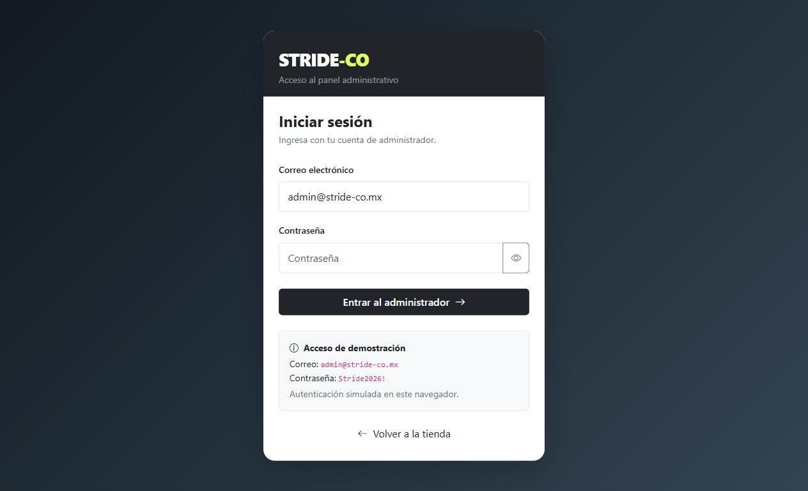
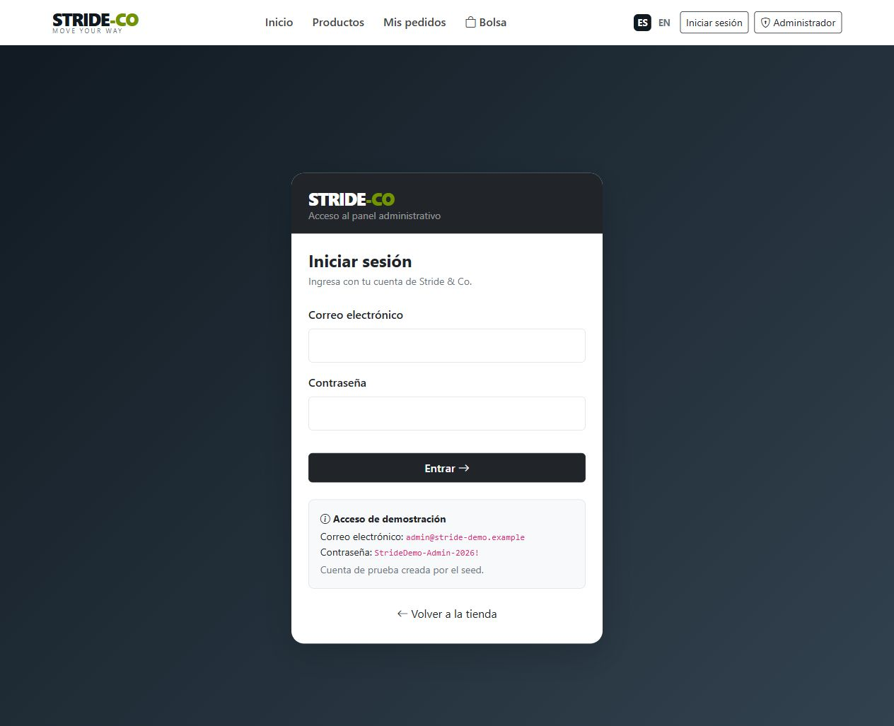
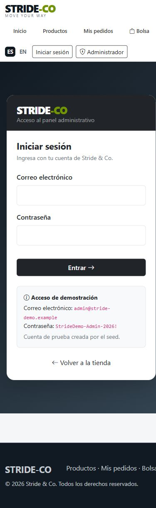
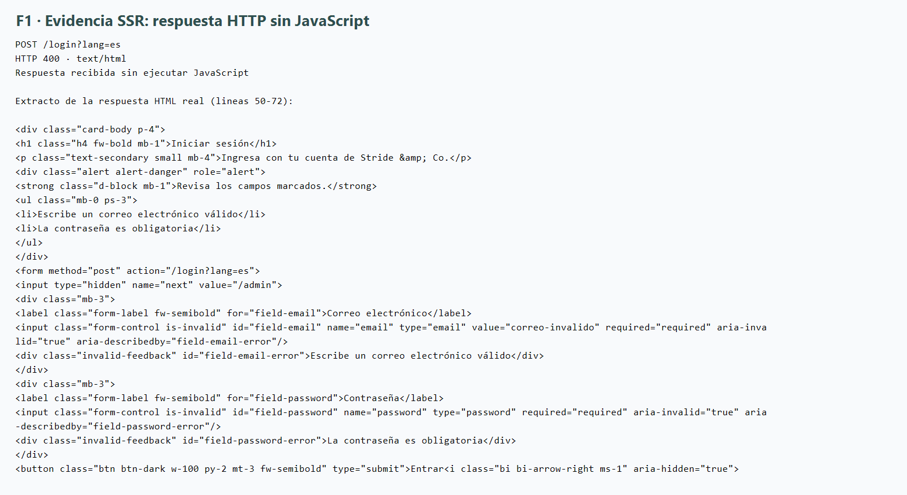

# F1 · Inicio y cierre de sesión (S3-04)

Responsable: Armando Velázquez Barroso. Issue: [#120](https://github.com/alex0726649/stride-co-app/issues/120).

Rutas: `GET /login`, `POST /login` y `POST /logout`, públicas. El servicio de credenciales es el mismo que usa la API. Las páginas protegidas de productos e inventario pertenecen a S3-07 y S3-08; su integración con `authenticate` y `authorize` se comprueba aquí con rutas exclusivas de pruebas.

## Prototipo e implementación

| Prototipo del profesor | Implementación con Pug |
|---|---|
|  |  |

Se conservan fondo, tarjeta, tipografía y formulario. Se usan las cuentas demo reales del seed; las del prototipo son ficticias y diferentes. La implementación añade el layout de tienda y ES/EN. No necesita JavaScript para enviar formularios ni cerrar sesión.

## Teléfono

Revisado en 390 × 844: campos y botones accesibles, sin desbordamiento horizontal (ancho de documento y viewport: 390 px).

## HTML generado en servidor

La herramienta de navegador no admite el protocolo `view-source:`. La evidencia equivalente es la [respuesta HTML original](f1-respuesta.html) y su [fuente en texto](f1-codigo-fuente.txt), obtenidas con Supertest, sin ejecutar JavaScript. Un POST inválido devuelve **400** con el email `correo-invalido`, el destino `/admin` y los errores traducidos ya presentes en el HTML; la contraseña no se incluye.

## Validación

- `test/web/auth.test.js`: español/inglés, validación por campo y email conservado, credenciales rechazadas, cookie HttpOnly/SameSite/Secure, destinos internos y externos, cierre de sesión y confirmaciones de un solo uso.
- Sesión opcional: cookie válida, inválida, expirada, usuario inactivo/eliminado, datos públicos limitados a nombre/email y permisos desde la BD.
- Rutas protegidas de prueba: 302 sin sesión y 403 HTML sin permiso; API con respuestas JSON y Bearer conservados.
- Las pruebas usan modelos/servicios simulados. Esta evidencia corresponde a la ejecución local, no al despliegue de Render (S3-10).
- `npm run lint`: limpio. `npm test -- --silent`: 19 suites y 441 pruebas aprobadas. `git diff --check`: limpio.
